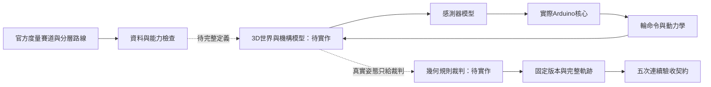

# 官方完整賽道：架構與五次驗收前置

## 目前結果

使用者確認目標是官方完整賽道模型，不能用工程測試線替代。本輪完成模擬架構的第一階段拆分及驗收契約；**完整賽道、3D機構世界與幾何規則裁判尚未完成，官方測試執行0次，連續完成0次，沒有達成五次通過。**

39項單元／原生程式測試通過，其中驗收器的成功紀錄僅為單元測試fixture，不是車子完賽資料。沒有為湊五次而放寬道路、跳過關卡或任意產生一條替代賽道。原生韌體及其速度／等待設定未修改。

## 官方資料核對

使用者指出11/6自駕車頁面後，再次核對官網：[全國自駕車創客賽－指定組頁面](https://www.tirtpointsrace.org/Registration/Event/ba032d0d-103c-4902-9559-b58fc8772b8b)目前標示比賽日期為2026-11-07；[10/31規則更新公告](https://www.tirtpointsrace.org/News/News/1038)也連往同一頁。該頁共六份PDF附件：中英文競賽總則、國小組及國高中職組規則。重新直接下載的國高中職中文規則仍與保存版完全相同。尚未找到另一份標示11/6、且補上完整賽道尺寸的官方自駕車頁面，不能據此斷言它不存在。

重新放大視讀第6頁後，補正先前漏列的圖面資訊：「立體賽道規格」圖的道路橫向標註為20，另有垂直標註19及4。這些數字在圖內沒有明示單位，不能直接全數換算為公尺，也不能由此替整張賽道指定比例。旁邊文字則明定白線寬2公分。這是部分尺寸資訊，仍欠各路段長度、彎曲半徑、上下層與機構配置。第3頁車體長小於20cm、寬小於16cm、高小於15cm、重不超過1.5kg及最多兩個驅動輪是參賽限制，不能當成實車輪距或感測器間距。以上已補入模型來源契約；未修改控制器或自行填滿度量路線。

本次從[11月7日指定組官方頁](https://www.tirtpointsrace.org/Registration/Event/ba032d0d-103c-4902-9559-b58fc8772b8b)重新直接下載中文PDF，1389853 bytes，SHA-256為8c42f4cf04e1d50424f92bc86fbb38ced78f3743b19384695de8e36485d21ef8，與保存版相同。網頁搜尋快取顯示過不同頁數／版次，故不以快取取代直接下載的位元組。核對本機PDF第5～7頁文字，並視讀第5頁地圖。

第5頁提供平面／立體與TAIWAN示意圖，但沒有可直接換算的完整公尺座標、路段尺寸及高低層連通表。T、V的指定出口與F標記也不能僅由字母或俯視交叉線自行決定。第6頁列捷徑邊界、蹺蹺板、升降台及立體線寬；這些是關卡條件，不是完整機械參數。[英文官方PDF](https://www.tirtpointsrace.org/Files/Docs/EventDoc/ba032d0d-103c-4902-9559-b58fc8772b8b/2026TIRT-Autonomous%20Vehicle%20Maker%20Challenge%20-%20Specific%20Group%20-%20Junior%20and%20Senior%20High%20School%20Student%20Group.pdf)另有關卡位置／數量由當日裁判決定的說明，須與中文規則及裁判確認，不能自行固定成正式配置。

`simulation/official_course.json`保存已確認的A～E關卡類型、規則來源／雜湊，並將10項未確認資料保留null；不是已完成的可駕駛路線。未確認內容包括度量幾何、行進方向／岔路出口、立體連通、關卡順序、捷徑界線、F、起終點、蹺蹺板／升降動力學及實車校正。

## 架構調整

已實作的責任分離：

- `firmware/native_car/controller.h`：只收ADC與時間、輸出輪命令；不提供真實位置、關卡編號或裁判答案給車子。
- `tools/simulation_model.py`：從physics_sim抽出無I/O的平面車輛、感測器與幾何模型。既有physics_sim匯出相容名稱，保留舊測試與工具。
- `tools/physics_sim.py`：管理閉迴路推進與軌跡，仍只是平面測試執行器。
- `tools/course_qualification.py`：官方資料完整性與五次結果契約，獨立於控制器的lapDone；目前不含3D世界或直接由幾何計算規則的裁判。
- `tools/run_simulation.py`：既有合成壓力情境及回放，不作官方驗收替代。



後續完整世界應使用(x,y,z,yaw,pitch)及分層道路，感測器投影到所在表面，不能把橋下線當橋上線。車體投影、每個驅動輪接地範圍、V彎例外、捷徑開始界線、方向／順序、升降已停妥與終點越線，都由裁判根據世界狀態計算。控制器的資訊仍受實際感測器限制，不能直接讀取模型位置來作弊。

目前23.35秒升降等待沒有機構完全停止回授，不能作為官方27秒機構完成的證明。不能只把常數改27秒就宣告此條件已通過。蹺蹺板翻轉、坡度造成的感測高度與抓地／負載變化，亦需實際機構與車型參數。

## 五次連續測試契約

固定程式及賽道雜湊、事前指定五個不同seed，不得途中改參數後拼湊成功紀錄。每次必須保留完整軌跡雜湊、有效時間與獨立檢查：起點越線、依序過關、車體涵蓋白線、車輪道路範圍與V彎例外、方向與層、捷徑、蹺蹺板、升降停妥後離開、終點越線及無故障／人工干預。

失敗打斷連續次數；缺任何檢查、途中換程式／賽道、重複seed、欠缺軌跡或NaN時間皆拒絕。`judge_batch`是結果契約而非幾何裁判；目前只有fixture測試，沒有真實官方run輸入。前置檢查更會拒絕不存在的3D能力，因此即使手填JSON完整，也不能假裝已有正式模擬器。

```powershell
py -3.11 -m unittest discover -s tests -v
py -3.11 tools/course_qualification.py
```

第二個命令目前預期exit code2，輸出blocked、executed_official_runs=0；這是未執行，不是五次失敗。實際報告見[官方驗收前置結果](simulations/2026-11-03-official-preflight.json)。舊工程壓力案例結果不計入五次。

## 下一階段必要輸入與工作

需要官方標尺寸路線／可校準俯視圖、起跑行進方向、各岔路指定出口、上下層連接及關卡配置／F定義；車子輪距、輪徑、感測位置與馬達性能也仍未量測。資料不足部分需主辦／裁判或現場測量確認。之後才能完成分層路線圖與3D機構／裁判，整合路線任務層，再凍結版本進行五次正式模型試驗。

這不是已交付完整官方賽道，也不表示後續只填幾個欄位即可直接通過。沒有燒錄、實車操作、發Release或合併PR。
