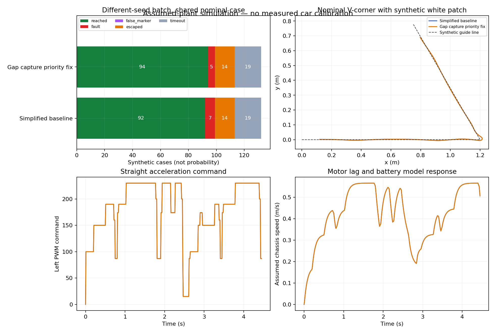

# 2026-11-02 物理情境模擬與回線交接修正

## 結論與採用範圍

這次不是只餵固定F序列：實際car.ino經桌面C++編譯後，由Python根據車身位置、感測器幾何及假設馬達模型產生ADC，讀取控制輸出，再推進車體位置，形成閉迴路。

嘗試過全面降速、降低直道最高命令及放慢升速。緩升速在第一批較好，換一批參數卻變差，因此**未採用緩升速為主程式設定**。實際採用的修正是：缺口已重新看到有效窄線時，先進行15 ms回線確認，不再被120 ms缺口期限搶先鎖停。速度仍為100／150／190／230，其他停止功能保留。

這是未校正的平面近似模型；結果不是實車成功率、整圈驗收，也沒有定位TAIWAN實際事故的唯一原因。官方圖不是有比例的完整路線，本次白面是合成圓形區域，並非重建真實TAIWAN文字或賽道。

## 已知資料、條件資料與未知資料

| 資料 | 證據與用途 |
|---|---|
| 車體長<20 cm、寬<16 cm、高<15 cm、重量1.5 kg內、最多兩驅動輪 | 本機官方PDF第3頁；是規格限制，不能當作實車量測值 |
| 白線2 cm | 官方PDF第6頁立體賽道規格；模型暫用此寬度，不能保證練習墊及平面路段皆相同 |
| V彎小於60度內角 | PDF第6頁圖示；需分開測車頭改向60／90／120度，內角60度通常對應改向120度 |
| CAGEBOT TR馬達4.5V、減速比1/55、130 rpm±10%、適用3～6V | [官方產品頁](https://www.cagebot.com/website/product_detailed/66/154)，本次查閱；未確認車上就是此型號，不直接套用為實車性能 |
| 馬達腳位、感測排列 | 專案hardware.md與主程式；舊硬體文件中的速度與感測黑白描述已過時／不一致，不拿來校正當次ADC |
| 輪距、輪徑、感測器前伸及間距、電池／驅動損耗、馬達起轉門檻、滑行距離 | 尚無這台車的實測資料，全部明確列為假設／可覆寫參數 |

官方PDF來源入口：[既有規則整理](TIRT_RULES_2026.zh-TW.md)及[本機原文](official_2026-10-25/rules_zh.pdf)。本次線上PDF讀取失敗，核對的是保存版本，不宣稱已排除後續公告更新。

官方130 rpm與輪徑仍不足以求實際速度：例如假設輪半徑3 cm，130 rpm對應輪緣速度約0.408 m/s，但負載、電壓、PWM與驅動壓降都會改變結果；本次沒有把這個例子當成車子實際速度。

## 模型實際考慮的因素

- PWM死區：低於起轉門檻時，目標輪速為0，不能假設PWM15就會穩定慢轉。
- 左右輪增益差、電池係數、馬達加速時間常數、有限加速度及零PWM滑行；方向反轉先經過減速，不能瞬間反向。
- 差速幾何：v=(vL+vR)/2，omega=(vR-vL)/輪距；以摩擦係數限制橫向加速度，超出部分作滑移近似。
- 感測器前伸、橫向間距、感測範圍、線寬及ADC雜訊；車身姿態改變後重新計算每顆感測器位置。
- 取樣週期與感測／決策延遲；模型將ADC延後送入真正的loop()。實際Arduino依序ADC讀取、LED中斷與CPU耗時尚未量測。
- 假設道路寬度下的輪子越界時間另列，不能只因最後到達出口就算全程合法。
- 主動記錄第一個turnFault成立時的原始碼行號與F值；停車後繼續讀ADC不會蓋掉原因。

使用一階輪速與加速度上限近似慣性，沒有實測質量／轉動慣量／馬達轉矩常數，不能稱完整剛體或電機模型。沒有重建輪胎接觸、齒輪背隙、驅動器煞車模式、電池內阻、坡道感測高度、蹺蹺板與升降機構；本次結果全部平面grade=0。MSVC桌面編譯也不等於AVR編譯，int寬度、函式庫、記憶體及執行時間仍有差異。

概念依據：[WPILib差速模擬](https://docs.wpilib.org/en/latest/docs/software/wpilib-tools/robot-simulation/drivesim-tutorial/diffdrive-sim-overview.html)、[馬達摩擦／速度／加速度模型](https://docs.wpilib.org/en/latest/docs/software/advanced-controls/controllers/feedforward.html)、[Arduino PWM說明](https://support.arduino.cc/hc/en-us/articles/9350537961500-Use-PWM-output-with-Arduino)。本專案使用小型平面近似器，沒有宣稱套件模型已適配CAGEBOT。

## 假設範圍與試驗設計

| 參數 | 名目值／掃描範圍 |
|---|---|
| 輪距 | 11.5 cm／9.5～13.5 cm |
| 感測器前伸 | 6 cm／4～8.5 cm |
| 感測器間距 | 1.4 cm／1.1～1.8 cm |
| 線寬／假設道路寬 | 2 cm／20 cm；後者不作官方道路寬宣稱 |
| 滿命令輪速尺度 | 0.65 m/s／0.4～0.85 m/s；刻意寬掃，非指定馬達實測轉速 |
| PWM死區 | 40／20～60 |
| 馬達時間常數／滑行時間常數 | 80 ms／40～140 ms；240 ms／120～350 ms |
| 加速度上限 | 2.5／1.5～4.5 m/s² |
| 左右增益／電池係數 | 左1、右0.97／各0.9～1.1；電池0.8～1.0 |
| 摩擦係數 | 0.55／0.3～0.8 |
| 取樣／額外延遲 | 2／5／10 ms；0／5／10／20 ms |
| ADC | 假設線35、背景500、雜訊標準差4；未驗證當次物理白面極性 |

基準為v0.4.0，精簡版為46bad64，修正版為本次重新產生的主檔。每份來源記錄SHA-256，設定固定亂數種子。同一參數／情境使用相同雜訊種子；不同軌跡的後續觀測仍會不同。每批含一個共用名目參數，其他參數由該批種子抽樣；不是完全獨立的實驗樣本，也不能將比例解讀為實車機率。

第一批8套參數×6情境，每方案48組：穩定版30組到達、精簡版38組、全面回到100的方案35組、緩升速41組。使用者實車穩定版能跑完的回報仍成立；穩定版在假設模型失敗，代表模型／幾何／版本對照尚未校準，不能反過來否定實車證據。

第二批seed=20261103，12套參數×11情境，每方案132組；包括左右鏡像60／90／120度改向及合成寬白彎。精簡版92組到達；緩升速候選79組到達，故障由7增加至25，其中24次為缺口期限在有效線上鎖停。因此拒絕將緩升速方案採用為預設。資料與修正版對比見[結果索引](simulations/2026-11-02-summary.json)。

保持原速度、只修正缺口回線交接後，以同一132組重新比較：

| 結果 | 46bad64精簡版 | 本次交接修正版 |
|---|---:|---:|
| 到達指定出口 | 92 | 94 |
| 故障 | 7 | 5 |
| 偏離合成指引線超過25 cm | 14 | 14 |
| 30秒內未到達 | 19 | 19 |
| 到達但曾超出假設道路輪子邊界 | 4 | 4 |

消除的兩次故障都是有效側線上缺口期限鎖停；仍有搜尋期限及F10故障。改善幅度小、沒有降低全部失敗來源；「到達」不等於全程合法。這批也不是統計上足以支持實車優越性的樣本。



緩升速候選為100／120／150／180，置中累積0／400／900／1500 ms，彎道不變。重播570步確認獨立XML產生的Arduino與對應參數試驗一致。保留可重建入口供研究，並非推薦設定。原候選停留在忽略的build-output/physics-candidate，之後改動控制來源時須重新產生再評估，不能沿用舊結果。

修正交接後也重新產生緩升速XML／INO，不能沿用舊候選。第二批132組中，修正版原速度到達94、故障5、逃離14；修正版緩升速到達101、故障3、逃離14。但再以seed=20261104的8套參數×11情境（88組，含共用名目參數）檢查：原速度到達66、故障5、逃離8、逾時9；緩升速到達67、故障1、逃離11、逾時9。較少故障伴隨更多逃離，不能只挑到達數宣稱較穩，故**主程式仍保留原速度**，不把緩升速視為已驗證的物理改進。

## 從物理限制找到的實作修正

原cross_gap()先判gapElapsed>=120，再看是否重新取得窄線。車子可能在119或120 ms回到線上，但還需要15 ms連續確認；下一圈卻先故障，與已看到有效線的事實矛盾。這解釋的是模型可達路徑，不是已證明TAIWAN當次事故。

新順序：有效窄線→立即前進收線、滿15 ms完成；F14→保留方向交給寬白恢復；其餘圖樣才檢查缺口期限。失去有效線會清掉確認，沒有刷新原始gapAt。無效圖樣及全程期限仍有效；兩個停止開關保持0。若關閉備援而要求鎖停，無效失線到期仍停，且後續輪命令不會覆寫故障輸出。

這個修正先處理階段交接，沒有把120任意加長，也沒有把15 ms改成猜測的「適合60度」數值。原有交替失線備援、寬白無局部期限、標記歧義仍是限制。

名目模型中，穩態PWM100／180／230分別約0.181／0.423／0.574 m/s；直接輸出0後的滑行約4.3／10.1／13.7 cm。這些是參數假設算出的例子，**不是實車量測**，用來提醒命令停止與實際停車位置不同。

## 重建與使用

以下命令在完整團隊Git庫`C:/Users/Yuhina/Documents/Codex/2026-10-24/tirt/team-repo`執行。E:/Projects/XiangyiRobotDreamFactory/self-driving_car是主檔／說明同步入口，該處既有Git尚無提交，不能用來讀取模擬所需的v0.4.0與46bad64來源。

Windows離線模擬需Python3.9+、MSVC cl或Visual Studio Community的vcvars64.bat；執行整個既有測試套件需Python3.10+，本次用3.11通過全部25項。系統預設3.9執行全套時，兩項舊temporal建置測試因Path.write_text(newline=...)不支援而失敗，改用3.11後通過；沒有為此修改保留候選。模擬核心只用Python標準函式庫；畫圖另需matplotlib。原廠Blockly產生器不隨Git散布，XML匯出仍用既有本機流程。

```powershell
py -3.11 -m unittest discover -s tests -v
python tools/physics_sim.py --samples 12 --seed 20261103 --models simplified --profiles unchanged --candidate car.ino --output build-output/physics-fixed
python tools/plot_physics.py build-output/physics-fixed/results.json --output build-output/physics-fixed/comparison.png
```

`--candidate car.ino`讀取目前主檔，對照的simplified固定取46bad64，不會因工作目錄變動而混淆基準。結果有JSON及名目情境10 ms CSV；原始碼行號對應每份固定來源，不可跨版本直接套用。

若要比較兩份其他版本，可用`--reference-source <第一份.ino> --candidate <第二份.ino>`。10項測試覆蓋PWM死區／滑行／加速度、模型輸入範圍、感測幾何、重播一致性、側線不反轉、三白出口、120 ms回線邊界、無效到期停車與寬白交接。原廠匯入接點及Arduino匯出通過，預設XML重新生成一致；未做Arduino目標編譯、硬體上傳或實車驗收。

有量測資料後，可用`--plant-json`提供JSON欄位覆寫，例如track_m、sensor_ahead_m、sensor_spacing_m、dead_pwm及motor_tau_s。欄位單位見Plant；部分覆寫後其他欄位仍是假設，不會自動變成已校正模型。

若要重建未採用的緩升速研究候選，使用`python tools/rewrite_car.py --speed-profile gentle --output build-output/physics-candidate/car.xml`，再循既有原廠匯出流程。非預設profile強制要求獨立output，避免無意改寫主檔。

## 後續最有價值的量測

先以尺／照片確認輪距、輪徑、感測器到輪軸前伸及各顆間距；核對馬達型號。若後續安排實車量測，記錄不同PWM的直線距離／時間、左右偏航、最低起轉／持續轉動門檻，以及PWM0後的滑行距離；同時記錄電池狀態及ADC。這些比繼續猜角度毫秒數更能約束模型。本次沒有連線車子、啟動馬達、燒錄或實車採集。
