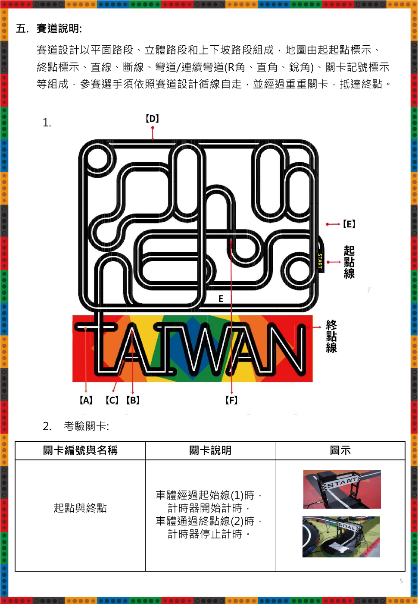
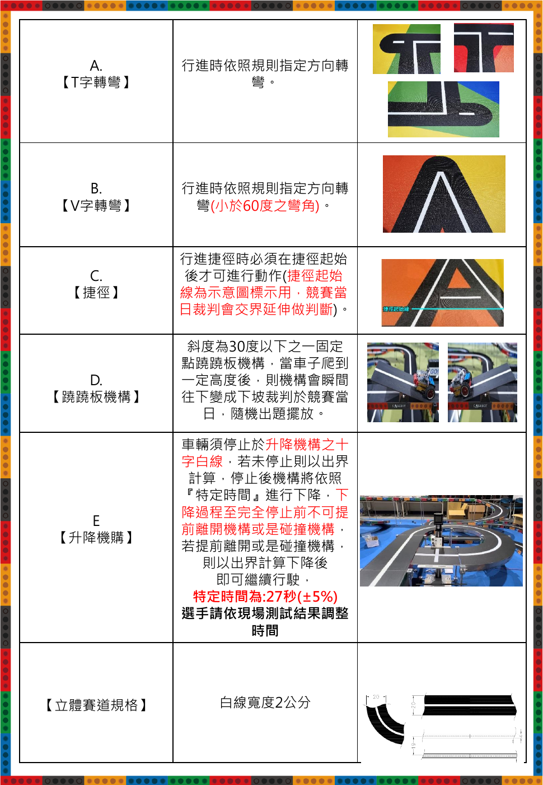

# 2026 TIRT 全國自駕車創客賽：指定組國高中職組規則整理

本文件依官方 PDF 重新閱讀、整理與解讀，方便隊友查閱及後續設計策略；不是逐字轉錄，也不取代官方規則或裁判解釋。頁碼均指 PDF 實際頁次，共 8 頁。

## 來源與版本

| 項目 | 紀錄 |
|---|---|
| 官方來源 | [國高中職指定組規則 PDF](https://www.tirtpointsrace.org/Files/Docs/EventDoc/ba032d0d-103c-4902-9559-b58fc8772b8b/2026TIRT-%E5%85%A8%E5%9C%8B%E8%87%AA%E9%A7%95%E8%BB%8A%E5%89%B5%E5%AE%A2%E8%B3%BD%E8%A6%8F%E5%89%87-%E6%8C%87%E5%AE%9A%E7%B5%84-%E5%9C%8B%E9%AB%98%E4%B8%AD%E8%81%B7%E7%B5%84.pdf) |
| 下載核對日 | 2026-10-25，臺灣時間 |
| 簡章日期 | 2026.04.09，第 1 頁 |
| 競賽規則版次 | 2026.09.30，第 3 頁 |
| 本機保存 | [本次下載的原始 PDF](official_2026-10-25/rules_zh.pdf) |
| 檔案大小 | 1,389,853 bytes |
| SHA-256 | `8C42F4CF04E1D50424F92BC86FBB38CED78F3743B19384695DE8E36485D21EF8` |
| 與既有保存版比對 | 與 2026-10-24 保存的 PDF 位元組雜湊相同 |

以下活動日期及截止日均是這份 PDF 的記載，不代表另行核對過最新活動公告。PDF 明載主辦單位可修正規則，變動以官方最新公告為準（第 2 頁）。

## 1. 賽事與參賽資格（第 1～3 頁）

活動以學生機器人程式、機電整合及創客實作交流為目的。指導單位為桃園市政府、桃園市議會，主辦單位為桃園市政府經濟發展局，承辦單位為財團法人桃園市祥儀慈善文教基金會。

| 項目 | PDF 所載內容 |
|---|---|
| 項目 | 全國自駕車創客賽，指定組 |
| 組別 | 國中組、高中職組，分組參賽 |
| 隊伍人數 | 每隊至多 3 名選手 |
| 學籍 | 須符合所屬組別並具有有效在學身分；國際同齡隊伍須有該國有效學籍證明 |
| 重複報名 | 同一隊員不得重複報名，違者取消資格 |
| 報名方式 | 經 TIRT 官方網站報名 |
| PDF 報名區間 | 2026-05-20～2026-09-25；文件註明可按報名狀況調整 |
| 比賽日期 | 2026-11-07，星期六 |
| 地點 | 桃園巨蛋，桃園市桃園區三民路一段 1 號；異動以官方公告為準 |

資格不符經查證後，主辦單位保留追回獎項及依法處理的權利。PDF 公開聯絡窗口為 03-3623452，分機 5338 覃先生、5339 劉先生（第 2 頁）。

## 2. 合法循跡的核心定義（第 3 頁）

車輛必須自主循跡競速，沿指定白線及指定方向完成路線。一般路段行駛時，**車體主體的正投影必須涵蓋白線**；虛線與捷徑路段另有例外。未符合循跡定義可能被判失格。

這個要求與「某一顆感測器有看到線」不同：感測器讀值只是控制輸入，合法性由車體與賽道的實際相對位置判斷。

出場順序由大會隨機安排；原則上每隊有一次取得成績的機會。現場可能依報到狀況增加次數或開放修改軟硬體，以裁判當日公告為準；有多次成績時取最佳成績。

## 3. 車輛硬體限制（第 3 頁）

| 項目 | 官方要求 |
|---|---|
| 指定零件 | 結構採 CAGEBOT 科技寶工程積木相關零件；控制板、感測器、齒輪箱馬達等使用官方指定零件 |
| 車型 | 輪型車 |
| 驅動輪 | 最多兩輪；輔助輪數不限 |
| 長度 | 靜止組裝狀態，含車輪總長 **<20 cm** |
| 寬度 | 含車輪總寬 **<16 cm** |
| 高度 | 總高 **<15 cm** |
| 重量 | 文件寫為 1.5 kg 內 |
| 能源 | 車上自行攜帶電池供電 |

長、寬、高使用嚴格「小於」，不能當成「等於上限也可」。這裡依本次直鏈下載的第 3 頁整理，不把其他年份、組別或快取版本的零件規定混入。指定零件參考頁：[CAGEBOT 官方產品列表](https://www.cagebot.com/website/product_list)。

## 4. 檢錄、起跑及競賽程序（第 4 頁）

1. 完成檢錄後，車體依規定放在大會指定區，不能自行取回或中途調整。
2. 裁判點名後，由一名指定隊員將車帶進場；同一場地同一時刻只安排一隊競賽。
3. 將車置於起跑區，**車上任何部分都不得越過計時起始線**。
4. 放置後有 1 分鐘可調整硬體、更換電池；此項須配合裁判程序，不能解讀為可隨時取回改裝。
5. **使用車上硬體開關啟動**，不得透過外部連線啟動。
6. 按規定路線完成關卡並到終點。起始線感測器自動計時，關卡是否通過由裁判判定。
7. 裁判確認成績、選手簽名後，再取回車輛放到指定區並等候結果。

## 5. 賽道、地圖與各關卡（第 5～6 頁）

賽道包含平面、立體、上下坡、實線、斷線、一般曲線、連續彎、直角、銳角及關卡標記。PDF 第 6 頁在立體賽道規格列出白線寬度為 **2 cm**。

### 官方地圖

圖上標示 A～F，關卡表則說明 A～E；**F 的對應功能未在這份表格中明確列出**，不能自行把它當成終點、岔路或捷徑。俯視投影相交也不代表兩條線在同一高度連通。

### 關卡要求

| 關卡 | PDF 明定的動作／條件 | 對控制策略的意義（本文件解讀） |
|---|---|---|
| 起點／終點 | 經過起始線啟動計時；通過終點線停止計時 | 完賽依場地計時系統，不能只靠程式內的時間或白區判定 |
| A：T 字轉彎 | 依指定方向轉彎 | 左右選擇須符合路線；當下哪邊先看到線不一定就是合法出口 |
| B：V 字轉彎 | 按指定方向通過小於 60° 的彎角 | 不能把規則的彎角直接當成馬達旋轉角或固定轉向時間 |
| C：捷徑 | 越過捷徑起始位置後才可執行捷徑動作 | 不可一失線就抄捷徑；圖中的起始界線是示意，現場由裁判延伸判定 |
| D：蹺蹺板 | 固定支點，斜度不超過 30°；車爬到一定高度後機構翻成下坡；當日由裁判隨機擺放 | 需面對坡度與感測器高度變化，不能由固定時間假定已通過 |
| E：升降機構 | 停在十字白線，等下降完全停止才可離開；文件給定時間 27 秒、容差 ±5% | 必須把該路段的十字停等與普通交叉通過區分開 |

### 升降台的特別要求

第 6 頁明定：沒有在十字白線停住、下降尚未完全停止便離開，或碰撞機構，皆按出界處理。下降結束後才可繼續行駛。

27 秒的 ±5% 算術範圍是 **25.65～28.35 秒**，但這只是容差換算，**不是授權車子等 25.65 秒就可先走**。原文另要求依現場結果調整；時間起算點、是否涵蓋全部下降過程，以及完全停止的判定，仍須釐清。

## 6. 成績排名與距離判定（第 3、7 頁）

| 情況 | 成績處理 |
|---|---|
| 6 分鐘內從起始線沿規定路線抵達終點、完成一圈 | 記錄場地計時器秒數，完賽時間優先排名 |
| 完賽隊伍不足得獎名額 | 依未完賽隊伍的行走距離遞補 |
| 全部隊伍都未完賽 | 依行走距離排名；距離相同再比時間 |
| 平面路段停止或出軌 | 依當下主動輪軸中心點相對位置記錄距離 |
| 立體路段停止或出軌 | 依外側數字記號判定區塊；相同記號區塊比時間，較快者優先 |
| 離開出發區後，中途失去動力且停止不動達 10 秒 | 改按距離計分 |
| 6 分鐘內未到終點 | 改按距離計分 |
| 衝撞設置的障礙物 | 改按距離計分 |

未完賽與失敗成績以當場裁判紀錄為主，原文載明不得賽後上訴；規則未能解釋的爭議由裁判團決定。

### 出軌定義與例外（第 7 頁）

由裁判從各角度看正投影：任一驅動輪離開黑色道路、碰到彩色區域，即按出軌處理。文件對小於 60° 的彎道列有例外，並指向 V 字彎圖示。

這項例外不能擴張成一般直角、普通彎、交叉或其他路段都可離開黑色道路。第 7 頁的 V 字圖示頁碼引用有誤，這份 PDF 實際的 B 關卡圖在第 6 頁，應以關卡名稱對照。

## 7. 失格與單輪機會失敗要分開看（第 4、7～8 頁）

### 失格

檢錄後至完賽前，未經允許接觸車體、利用通訊修改程式、干擾競賽或違反規定，可能失格；嚴重影響其他隊伍或破壞、汙損場地也屬失格情形。失格不計完賽成績。

### 該輪機會失敗

- 裁判唱名三次未到，或點名後 30 秒內仍無法進場準備。
- 比賽開始後 10 秒內未從起點離開出發區。

不要把上述「出發 10 秒」與「途中停住 10 秒」混為同一條規則；前者是該輪失敗，後者列在距離計分條件。

## 8. 獎勵（第 8 頁）

| 名次 | PDF 表列獎金 | 獎狀 |
|---|---:|---|
| 第一名 | 5,000 元 | 乙張 |
| 第二名 | 3,000 元 | 乙張 |
| 第三名 | 2,000 元 | 乙張 |
| 佳作 | 未列金額 | 乙張 |

表格下方另註高中職指定組的獎狀僅為桃園市政府獎狀。此處按 PDF 表格整理，不額外推論個人獎狀份數或各名次名額。

## 9. 與目前 car.xml 的關係（專案解讀，不是官方新增規定）

目前專案主檔是三感測器循跡、尖角轉向、短缺口直行、升降台候選與測試墊終點停車；以下只比對規則與已知設計，不表示本次驗證過實車。

| 目前設計／現場回報 | 規則角度的判讀 |
|---|---|
| A4/A3/A2 做控制，A5/A1 僅記錄 | 規則沒有指定要用三顆或五顆，也沒有指定 PWM；必須以實際循跡、合法車體位置和指定方向判定 |
| 60°／90° 尖角使用回線式樞紐轉向 | 規則沒有要求馬達固定轉 60°／90°；關鍵是經過正確出口並符合該路段條件 |
| 第 14 段應右轉，卻曾左轉約 180° 後停車 | 左右應依實際路線；這是使用者提供的測試場段號，不是官方地圖 A～F 的自動對應 |
| 三顆全亮 F=14 做低速通過／終點候選 | 一樣的感測圖樣也可能是交叉或升降台十字，不能全部當成通過或終點 |
| 運行滿 15 秒、F=14 持續 250 ms 後停止 | 這是測試墊上的候選參數，官方沒有這兩個數值；不能據此認定完成正式一圈 |
| 全黑 F=0 短缺口直行 | 規則允許虛線路段有循跡例外，但不是任何失線都可以任意前進或改走路線 |
| 轉向 800 ms、缺口 250 ms 逾時停車 | 都是專案保護參數；不是官方關卡時限 |
| 整次運行 180 秒上限 | 是專案自己的上限，與官方 6 分鐘計分門檻不同 |
| 測試照片下方大片白區當終點、左側窄線起跑 | 是使用者指認的練習場配置，不能取代正式場地起終點計時線 |
| 後續新增升降台候選流程：第一個確認寬白事件停等23.35秒後離台（依使用者要求縮短5秒） | 依使用者「途中似乎沒有其他十字」的假設選擇事件；不是升降台位置辨識，也沒有下降完全停止回授，不能稱為已符合正式關卡 |
| 現行主檔沒有完整正式路段順序 | 尚不足以涵蓋官方完整關卡；不能稱為正式賽程式已完成 |

**策略優先順序的解讀**：一般循跡與尖角恢復只是底層動作；指定 T／V 出口、捷徑邊界、升降台停等與終點計時線，還需要可辨識的路段上下文。官方 PDF 並沒有提供可直接匯入程式的完整有向路線或實車時間參數。

## 10. 文件無法直接回答的事項

以下保留為待釐清問題，不用任意猜測填入韌體：

1. 正式行進路線、各 T／V 出口方向、立體交會點的連通方式及地圖 F 的定義。
2. 捷徑是否全程必做、是否可走原白線替代，以及現場起始邊界如何辨識。
3. 升降台 27 秒從何時起算、是否包含整段下降、如何確認完全停止。
4. 升降台必要等待如何與一般途中停止 10 秒的計分條文區分。
5. 正式終點感測器位置、車體通過到何處才完成計時，以及停車應放在通過後多遠。
6. 現場增加出賽次數、允許修改的時機與範圍，以及晚於本 PDF 的公告異動。

## 11. 頁碼索引

| PDF 頁次 | 內容 |
|---|---|
| 1 | 簡章背景、目的、主承辦及參加對象 |
| 2 | 分組、人數、報名、賽期、地點及修正公告 |
| 3 | 2026.09.30 規則、循跡定義、賽制與車體規格 |
| 4 | 檢錄、起跑、啟動方式、競賽程序及失格 |
| 5 | 官方地圖、起終點及計時說明 |
| 6 | T／V、捷徑、蹺蹺板、升降台、白線規格 |
| 7 | 時間／距離成績、出軌及失敗條件前段 |
| 8 | 唱名／起跑失敗條件及獎勵 |

規則整理當次僅建立文件與來源保存。後續升降台功能另見 [候選流程](LIFT.zh-TW.md)，文件中的官方要求與實作假設仍須分開閱讀。
