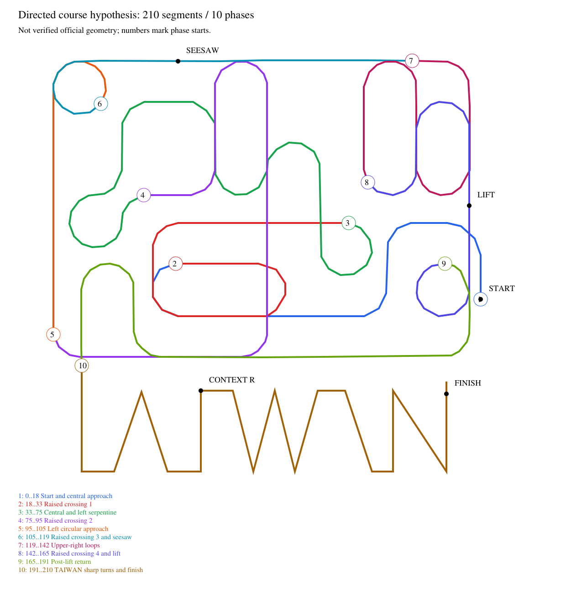

# 起點到終點：逐段情境、策略與實際模擬

本次重新執行完整賽道，既有 junction_context 參考策略完成209/209檢查點，模擬起終點計時218.880秒；新兩層控制的空任務基準於103.305秒、82/209停止。兩者使用相同seed2026110711、相同物理參數與相同地面支撐模型，沒有把成功結果移植成新版已完賽的宣稱。

這是官方圖面推定模型，不是現場量測賽道。seed711是已知診斷案例；不是新的盲測或五連跑。模型的路線方向、層次、機構位置、材料與車輛能力仍有假設。保留的741..745種子未使用。

## 全路線覆蓋與應對

模型共有211個頂點、210個有方向路段、209個裁判檢查點。頂點／路段均從0編號，下表十段連續覆蓋全路線。[逐一列出210路段的表格](SCENARIOS.md)及[機器可讀分析](scenarios.json)包含轉向角、坡面、交疊、附加白線、機構與策略；數字是模型座標與尺度，不能用作實測距離。



| 頂點範圍 | 情境 | 採用／待補的應對 | 本次參考通過時間（模擬起算秒） |
|---|---|---|---|
| 0–18 | 起點、右側入彎、中央入口 | 中央三顆連續位置PD；偏移增加時減速。正式計時由物理起點越線開始 | 0–14.425 |
| 18–33 | 第一立體交疊、上下坡、中央重複路段 | 同一循線控制；模型依高度決定感測到哪層，控制程式不讀高度答案 | 14.425–31.030 |
| 33–75 | 中央與左側蛇形、連續彎 | PD與短暫方向記憶；回線確認、失線期限均有限 | 31.030–53.145 |
| 75–95 | 第二立體區、中央縱向、下方橫向 | 交叉白線只產生觀測，不直接判升降；以實際ADC反應 | 53.145–75.115 |
| 95–105 | 左側長直段接圓彎 | 持續修正位置；不以見到中央線推斷前方一定直行 | 75.115–84.665 |
| 105–119 | 第三立體區、左圓重疊、上方蹺蹺板 | 115→116通過模型蹺蹺板，仍靠循線與假設牽引力；沒有車上坡度／倒退回授 | 84.665–101.360 |
| 119–142 | 上方右側連續U形彎 | 正常PD、降速、方向恢復 | 101.360–115.205 |
| 142–165 | 第四立體區、升降台、接收平台 | 154→155由已綁定的感測事件前綴識別升降，停止31秒，出口須100ms窄線、1500ms內完成 | 115.205–164.890 |
| 165–191 | 升降後圓彎、下方迴轉、進入文字形賽道 | 外側提示與已選方向收線；不能讓普通交叉任意改變任務 | 164.890–182.240 |
| 191–210 | TAIWAN直角／V形急彎、岔線、終點 | 模型頂點198的特定前綴選右；其餘仍由循線／找線處理。捷徑停用，沿A頂點完整繞行；物理終點越線結束試驗 | 182.240–219.320 |

210個分段中，174段帶曲線轉角標籤、10段銳利轉向、6段V角、26段高度變化、44段含幾何交疊、5段與附加白線相交。這些是折線取樣分類，標籤可重疊，**不是174個正式彎道或44個正式岔路**。

## 哪些策略確實進入控制程式

本次完整圈使用既有 `firmware/experiments/junction_context` 與 `simulation/junction_context_ground_mission.json`，經程式／模型身分核對後編譯。沒有修改權重、擴大合法道路、放寬裁判或直接餵入車子位置。

一般路段採連續位置與濾波PD；左右事件和寬白組成可觀測前綴。升降任務由既有訓練前綴啟用。升降後的 `R L W L R L R L W` 只在最後一個W給出右轉決策，並一次性消耗。其餘寬白不會自動觸發同一決策。這項選右是目前重建路線的策略，不是已核實的官方指定出口。

本次重新生成的物理ADC和實際C++控制輸出皆通過重播核對，獨立裁判的10項檢查全部通過。原始模擬從0秒到219.320秒；起點越線發生於0.440秒，因此起終點計時218.880秒。推定升降機構模型本次抽到26.671秒；程式於125.005秒停車、156.005秒開始離台、156.250秒完成窄線確認。

祥儀現場23350ms設定沒有修改。參考策略的31秒等待是另一個既有模型策略，不能用此次通過推論現場23.35秒是否充分。車上並無機構穩定感測器。

## 新兩層控制實際測到的落差

同一個物理世界內直接編譯 `layered_car` 真實核心，使用目前空路線／field設定；只輸入ADC與時間，不提供位置、檢查點或升降就緒真值。按鈕等待不計入本次核心試驗，硬體adapter另有既有測試。

它通過82個檢查點後，在103.305秒觸發Signal故障。末段A4/A2約30–40、A3約400，呈現左右有線而中央較弱的分裂線形；核心沒有可用任務方向，800ms不確定期限到達後鎖停。此前已經有短暫不確定及回線，不能把全部停頓視為同一個持續失線段。裁判同時未通過全程方向／完整路線檢查，因此不只是少了一個升降設定。

這提供了下一步具體目標：先將該岔路之前的可觀測歷史、對應出口與回線序列整理成明確任務，再驗證真實核心；不能靠延長800ms或忽略Split讓車盲目前進。參考版已完成的圈不等於新的兩層架構已完成。

## 模型尚未涵蓋的實際情境

圖面向量模型沒有明確編入所有正式斷線區間，也沒有任意白色競賽文字、現場機構擺位變動、完整輪子／車體接觸、翻覆、測得的輪胎滑移與馬達扭矩。完整圈成功不能代替這些情境的定向測試。F的用途、官方指定出口與真實層次仍未核實。

捷徑採不走的策略；其界線沒有被假設成車上可讀標記。參考程式尚無車上終點停車偵測，本次由獨立裁判確認物理越線後終止模擬。新架構的Finish也是待配置的停止地標，不能冒充官方計時器。

## 重播與重現

- 完整圈：[本機互動重播](../../build-output/start-finish-20261105/reference-711/index.html)
- 新兩層基準：[本機失敗重播](../../build-output/start-finish-20261105/layered-711/index.html)
- 短摘要與雜湊：[結果收據](results-summary.json)。原始CSV、來源、物理參數和模型凍結於各批次，未納入Git的大檔不會隨GitHub文件下載。

```powershell
py -3.11 tools/analyze_course_scenarios.py --course simulation/reconstructed_course_ground.json --output build-output/my-scenario-catalogue
py -3.11 tools/run_course.py --course simulation/reconstructed_course_ground.json --source firmware/experiments/junction_context/junction_context.ino --candidate-profile simulation/junction_context_ground_mission.json --plant-json simulation/plant_high_torque_hypothesis.json --probe-seed 2026110711 --diagnostic-limit-s 360 --output build-output/my-full-reference
py -3.11 tools/audit_course_run.py build-output/my-full-reference
py -3.11 tools/run_layered_course.py --reference build-output/my-full-reference --output build-output/my-layered-baseline
```

全部為離線模擬；沒有燒錄、馬達操作或更換下載頁。既有參考的重播核對不計為新的隨機試驗。這次僅各跑一個案例，沒有尋找有利種子或重複調參。
